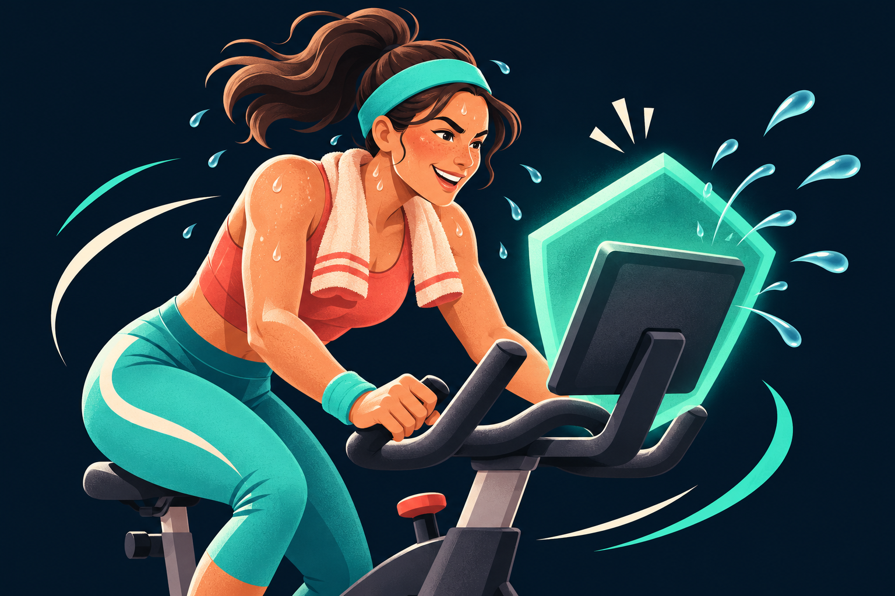

# Touch Guard

**Sweat away and get that PR!**

Touch Guard catches accidental sweat touches on an indoor bike screen. One app, one Android accessibility entry, two modes selected in its settings:

| Mode | Behavior |
| --- | --- |
| **Full Screen Lock** | Blocks every screen touch while your workout stays visible. |
| **Lock with Social Access — experimental** | Keeps the full blocking layer in place and invokes only recognized avatar high-fives, leaderboard scrolling, song-card opening, and song hearts. Other controls stay blocked. Incoming high-five replies are implemented experimentally and remain unverified. |

Hold **Volume Down for five seconds** to turn either mode ON or OFF. Release fully between holds. Social mode is currently limited to **30 seconds** for testing.



## Download and setup

[Download v0.2.0-preview2](https://github.com/murface/touch-guard/releases/tag/v0.2.0-preview2) · [Installation](docs/INSTALLATION.md) · [Testing and limitations](docs/TESTING.md) · [Privacy](PRIVACY.md)

Install the signed APK through OpenPelo's **Install local APK** option while the bike is idle. Enable the single **Touch Guard** entry in Android Accessibility. Leave Android's separate accessibility shortcut OFF. Open the entry's **Settings** row, choose your lock mode, and complete the 30-second hardware-unlock test. A computer and developer debugging access are needed for installation; this is not a Play Store app.

Existing installations can update using the same signing identity. Android may ask you to re-enable Touch Guard because this version combines local control access and key filtering into one permission. Preview1's separate Social Access entry has been removed.

## Early preview — limited testing

Touch blocking, the automatic test timeout, and physical five-second ON/OFF toggles were tested on one Original Peloton Bike tablet **PLTN-RB1V0-2, Android 11**. The single-service preview installs and its menu displays on that bike. Build and shortcut/social-policy unit tests pass.

**The new Social actions have not yet passed end-to-end workout testing.** Incoming high-five replies, a full sweaty ride, continuous class video/audio/metrics, and the complete emergency-recovery checklist remain unverified. The control whitelist supports only Peloton workout app versionCode **2083457** (2.8.3457); unsupported screens fall back to Full Screen Lock. Unknown actions stay blocked. Leaderboard swipes move one page at a time.

Bike+, Tread, other tablets/firmware, and other Android versions are untested. Android below 11 is unsupported. [v0.1.2](https://github.com/murface/touch-guard/releases/tag/v0.1.2) remains available as the older Full Lock-only beta; its permission model differs.

## Shortcut and recovery

A short Volume Down press lowers media volume one step on release. Holding it for five seconds toggles protection without adjusting volume. Continuous long-press volume adjustment is replaced while this shortcut is enabled. Optional both-volume-button mode can conflict with Android's accessibility shortcut.

The first lock after a service restart or shortcut change lasts at most 30 seconds. Unlock it with the hardware shortcut to enable longer **Full Screen Lock** durations (30/60/90/120 minutes). Social preview locks remain capped at 30 seconds.

Unlock using the five-second shortcut or let the timer expire. Other implemented escapes include display power-off, a notification action, and the [Mac emergency helper](scripts/Unlock-Touch-Guard.command). Three-finger eight-second escape is experimental and **OFF by default**; sweat-contact testing is pending. Verify recovery while idle. Protection starts OFF after restart; an enabled accessibility service does not itself mean the screen is locked.

## Privacy and permissions

One accessibility permission covers key filtering, a transparent blocking overlay, and local control access for Social mode. **Full Screen Lock does not inspect screen content.** Social mode checks Peloton control IDs, positions, and high-five wording locally during protected gestures. No screen data is saved or uploaded. No internet permission, accounts, analytics, ads, rooting, or changes to Peloton's workout app. See [Privacy](PRIVACY.md).

## Build

Requires JDK 17, Android SDK platform 35, and build-tools 35.0.0. The wrapper uses Gradle 8.11.1, Android Gradle Plugin 8.9.1, and Kotlin 2.1.20.

```sh
./gradlew :app:assembleDebug :app:testDebugUnitTest
```

Debug APKs use a different signing identity and cannot update the distributed APK directly. Optional release signing reads `TOUCHGUARD_KEYSTORE`, `TOUCHGUARD_STORE_PASSWORD`, `TOUCHGUARD_KEY_ALIAS`, and `TOUCHGUARD_KEY_PASSWORD`. No signing secrets are distributed.

## Community

Please report tablet model, Android/Peloton OS and workout app versions, and exactly which functions you tested. Do not include pairing codes, credentials, or private ride screenshots. [OpenPelo catalog request](https://github.com/doudar/Openpelo/issues/69) is pending; inclusion is the maintainer's decision.

Independent community project, not affiliated with or endorsed by Peloton or OpenPelo. MIT license; third-party notices are included. The original cycling illustration was AI-generated and its prompt is recorded in `artwork-prompt.txt`.
